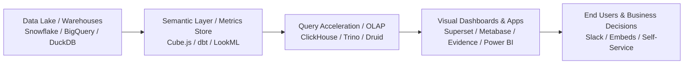

  

# 🌐 Awesome Cloud Business Intelligence (BI)   

> 🚀 **The definitive, curated directory of Cloud Business Intelligence (Cloud BI) platforms, self-service enterprise analytics, semantic layers, and open-source data visualization tools.**

Whether you are evaluating modern enterprise SaaS BI tools or deploying self-hosted, privacy-first open-source analytics engines, this guide provides side-by-side pricing, free tier limits, company valuation metrics, and GitHub star rankings to accelerate your data architecture decisions.

---

## 📑 Table of Contents

- [📊 Sector Overview & Market Dynamics](#-sector-overview--market-dynamics)
- [🏢 Enterprise SaaS & Hosted BI Platforms](#-enterprise-saas--hosted-bi-platforms)
- [⚡ Open-Source GitHub Projects](#-open-source-github-projects)
- [🛠️ Modern BI Architectural Patterns](#️-modern-bi-architectural-patterns)
- [🤝 How to Contribute](#-how-to-contribute)
- [⚖️ Disclaimer](#️-disclaimer)

---

## 📊 Sector Overview & Market Dynamics

The global Cloud Business Intelligence market is valued at approximately **$30.8 billion in 2026** and is projected to expand at a **CAGR of ~14.2%** to reach upwards of **$60 billion by 2031**, driven by AI agent integration, real-time streaming OLAP, and lakehouse-native query engines. 

The sector displays a **moderately concentrated, bifurcated market structure**:
- **Consolidated Tier 1 (Hyperscalers & Enterprise Giants)**: Giants like Microsoft (Power BI / Fabric), Salesforce (Tableau), and Alphabet (Looker) control substantial market share through ecosystem bundling, deep enterprise agreements, and native cloud integrations.
- **Dynamic Specialist Tier**: The rest of the market remains competitive and fragmented with specialized innovators carving out strong niches — notably **Sigma Computing** (spreadsheet-native lakehouse BI), **ThoughtSpot** (search/agentic AI analytics), and vibrant **Open-Source alternatives** (Superset, Metabase, Cube, Lightdash) adopted by teams demanding data sovereignty, headless semantic layers, and zero vendor lock-in.

---

## 🏢 Enterprise SaaS & Hosted BI Platforms

Below is a detailed comparison of industry-leading commercial cloud business intelligence solutions. The table is ordered by **Company Scale / Market Valuation (Descending)** to illustrate enterprise footprint, with exact entry-level pricing and verified free tier / free trial limits.

| Product / Company | Company Scale (Valuation / Revenue) | Starting Pricing (Specific Tier) | Free Tier / Free Trial Limits | Key Highlights & Core Differentiators |
| :--- | :--- | :--- | :--- | :--- |
| **[Microsoft Power BI](https://powerbi.microsoft.com/)** | **~$3.1T Market Cap** (Microsoft; Power BI est. $4B+ ARR) | **$10/user/month** (Power BI Pro) | **Free forever plan** (Power BI Desktop: full authoring & local modeling; cloud publishing/sharing requires Pro) | Native Microsoft Fabric integration, Direct Lake querying on OneLake without data movement, and Copilot AI integration. |
| **[Looker (Google Cloud)](https://looker.com/)** | **~$2.1T Market Cap** (Alphabet; Looker acquired for $2.6B) | **$5,000/month** (Looker Standard platform fee + $30–$125/user/month) | **30-day free trial** (up to 10 users with full LookML and exploration capabilities via Google Cloud) | Centralized semantic layer defined via Git-governed LookML, headless embedded analytics APIs, and native BigQuery optimization. |
| **[Salesforce Analytics Cloud (Tableau)](https://www.salesforce.com/analytics/)** | **~$280B Market Cap** (Salesforce; Tableau acquired for $15.7B) | **$75/user/month** (Tableau+ / CRM Analytics starting tiers) | **30-day free trial** (Salesforce CRM Analytics trial environment with sample datasets) | Deep two-way integration with Salesforce CRM, native Einstein AI-driven predictive insights, and automated workflow triggers. |
| **[Tableau Cloud](https://www.tableau.com/products/cloud-bi)** | **~$280B Market Cap** (Parent: Salesforce) | **$15/user/month** (Viewer; Creator at $75/user/month) | **14-day free trial** (full Tableau Cloud Creator features, Tableau Pulse AI metrics, and hybrid Tableau Bridge access) | Industry standard in visual drag-and-drop exploration, Tableau Pulse automated Slack/Teams metrics, and rich calculated fields. |
| **[Qlik Sense](https://www.qlik.com/)** | **~$10B+ Valuation** (Thoma Bravo PE backed; ~$800M+ revenue) | **$825/month** (Standard tier billed annually, includes 25GB data / 20 users) | **30-day free trial** (full Qlik Cloud Analytics capabilities, multi-source data ingestion, and associative engine exploration) | Proprietary in-memory Associative Engine uncovering hidden data relationships without rigid relational hierarchies. |
| **[ThoughtSpot](https://www.thoughtspot.com/)** | **~$4.5B Valuation** (Privately held unicorn) | **$95/user/month** (ThoughtSpot Analytics Pro tier) | **14-day free trial** (unlimited natural language Spotter AI queries, connected live to your cloud data warehouse) | Pioneer in search-driven and agentic BI, Spotter AI autonomous querying, and developer SDKs/MCP for embedded data apps. |
| **[Sigma Computing](https://www.sigmacomputing.com/)** | **~$3.0B Valuation** (Series D, 2024–2026; $100M+ ARR) | **$20/user/month** (Starting Viewer tier; Builder/Creator at custom scale) | **14-day free trial** (full access to live warehouse spreadsheet exploration on Snowflake, Databricks, or BigQuery) | Familiar spreadsheet interface operating directly on billion-row cloud data warehouses without extracting data. |
| **[Sisense](https://www.sisense.com/)** | **~$1.5B+ Valuation** (Privately held; $150M+ ARR) | **$833/month** (~$10,000 billed annually starting package) | **30-day free trial** (Sisense Cloud environment with live ElastiCube modeling and embedded analytics SDKs) | Specialized in white-label embedded analytics, composable widgets, and ElastiCube high-speed in-memory data caching. |
| **[Domo](https://www.domo.com/)** | **~$400M Market Cap** (NASDAQ: DOMO; ~$320M annual revenue) | **$300/month** (Standard platform base package) | **Free forever plan** (Free tier for up to 300 credits/month and standard connector refresh rates; or 30-day unlimited trial) | Comprehensive end-to-end platform featuring 1,000+ pre-built API connectors, mobile-first dashboards, and self-service ETL. |
| **[GoodData](https://www.gooddata.com/)** | **~$250M Valuation** (Privately held venture backed) | **$20/user/month** (Starting Professional edition tier) | **30-day free trial** (includes full multi-tenant workspace isolation, metrics store, and DuckDB/Iceberg engine connectivity) | Composable headless BI framework with Apache Iceberg & DuckDB Analytics Lake engines, metrics-as-code, and multi-tenant isolation. |

---

## ⚡ Open-Source GitHub Projects

Open-source BI projects empower engineering teams to maintain full control over compliance, customize semantic layers, avoid recurring per-seat SaaS costs, and achieve transparent version control.

The list below is ordered by **GitHub Star Counts (Descending)**. Star badges link directly to each repository's stargazers community.

| Project | GitHub Stars (Social Badge) | License | Architecture & Key Strengths |
| :--- | :---: | :---: | :--- |
| **[Grafana](https://github.com/grafana/grafana)** |  | AGPL-3.0 | Ubiquitous observability, timeseries, and SQL dashboard engine. Extensive plugin ecosystem, granular alerts, and unified multi-source panels. |
| **[Apache Superset](https://github.com/apache/superset)** |  | Apache-2.0 | Flagship open-source enterprise BI web application. Features 40+ visualization types, robust SQL Lab editor, semantic datasets, and enterprise RBAC. |
| **[ClickHouse](https://github.com/ClickHouse/ClickHouse)** |  | Apache-2.0 | Blazing-fast column-oriented OLAP database management system powering real-time analytics, sub-second aggregations, and petabyte-scale BI backends. |
| **[Metabase](https://github.com/metabase/metabase)** |  | AGPL-3.0 | The most accessible self-service BI platform. Intuitive visual query builder, Metabot AI assistant, simple single-JAR Docker deployment, and embedded sharing. |
| **[Streamlit](https://github.com/streamlit/streamlit)** |  | Apache-2.0 | Fastest framework for turning Python data scripts into shareable, interactive BI web apps, custom charts, and machine learning visualization dashboards. |
| **[DuckDB](https://github.com/duckdb/duckdb)** |  | MIT | High-performance in-process analytical SQL database ("the SQLite for Analytics"). Powers local fast-query BI, Parquet parsing, and serverless analytics engines. |
| **[Redash](https://github.com/getredash/redash)** |  | BSD-2-Clause | Collaborative query editor and visualization platform. Query data across heterogeneous databases, automate scheduled refreshes, and set threshold alerts. |
| **[DataEase](https://github.com/dataease/dataease)** |  | GPL-3.0 | Modern open-source data visualization analysis tool. Drag-and-drop dashboard design, connects to dozens of SQL and Excel sources, highly accessible UI. |
| **[Apache Druid](https://github.com/apache/druid)** |  | Apache-2.0 | Real-time analytics database engineered for fast sub-second slice-and-dice queries on massive streaming event streams and high-concurrency BI apps. |
| **[dbt-core](https://github.com/dbt-labs/dbt-core)** |  | Apache-2.0 | Industry standard data transformation framework enabling analytics engineering, version-controlled SQL models, and semantic metric definitions. |
| **[Trino](https://github.com/trinodb/trino)** |  | Apache-2.0 | Distributed SQL query engine engineered for federated high-speed analytics on data lakes (S3, Iceberg, Delta Lake, HDFS) across heterogeneous sources. |
| **[Cube.js](https://github.com/cube-js/cube)** |  | Apache-2.0 | Universal semantic layer and headless BI platform. Provides centralized metric definitions, automatic pre-aggregations, caching, and REST/GraphQL/SQL APIs. |
| **[Evidence](https://github.com/evidence-dev/evidence)** |  | MIT | "BI as Code" framework where interactive reports are built as Markdown (`.md`) files containing SQL queries, managed in Git, and deployed as fast static sites. |
| **[Lightdash](https://github.com/lightdash/lightdash)** |  | MIT | Native self-service BI tool built on dbt. Turns dbt YAML metrics into interactive explore spaces, dashboards, and automated Slack scheduled deliveries. |
| **[Rill Developer](https://github.com/rilldata/rill)** |  | Apache-2.0 | Fast operational BI tool combining embedded DuckDB/ClickHouse with code-native YAML dashboards, sub-second metric exploration, and instant local profiling. |
| **[Knowage](https://github.com/KnowageLabs/Knowage-Server)** |  | AGPL-3.0 | Comprehensive enterprise open-source BI suite by Engineering Group covering reporting, KPI management, geo-spatial intelligence, and R/Python data science. |

---

## 🛠️ Modern BI Architectural Patterns

Modern Cloud Business Intelligence stacks follow composable, decoupled architectural patterns:

1. **Warehouse / Lakehouse-Native Analytics**: Eliminates siloed data extraction; platforms like Sigma, ThoughtSpot, and Evidence execute analytical queries directly against Snowflake, Databricks, BigQuery, or DuckDB.
2. **Headless Semantic Layers**: Centralizes business metrics (e.g., definitions for "Monthly Recurring Revenue", "Active Users") in code (Cube, dbt Semantic Layer, LookML) ensuring uniform figures across every frontend.
3. **BI as Code (GitOps for Analytics)**: Dashboards and models stored in Git repositories with peer reviews, CI/CD validation, and zero manual drift.

---

## 🤝 How to Contribute

We welcome contributions from the data engineering and analytics community!

1. 🍴 **Fork the repository** on GitHub.
2. 🌿 **Create a new branch** (`git checkout -b feature/add-bi-tool`).
3. 📝 **Add or update an entry** in `README.md`:
   - Keep entries strictly factual and link to authoritative documentation.
   - For SaaS products, include exact starting tier pricing, free tier / trial limits, and valuation/revenue context.
   - For open-source tools, include the correct repository link and social star badge.
4. 🚀 **Submit a Pull Request** with a concise description of your changes.

---

## ⚖️ Disclaimer

- This repository is a community-curated directory intended for research, architectural planning, and educational purposes.
- All product names, logos, and brands are property of their respective owners. Mention does not constitute an endorsement.
- SaaS pricing, commercial packaging tiers, and valuations reflect public market data as of 2026 and are subject to change by vendors.
